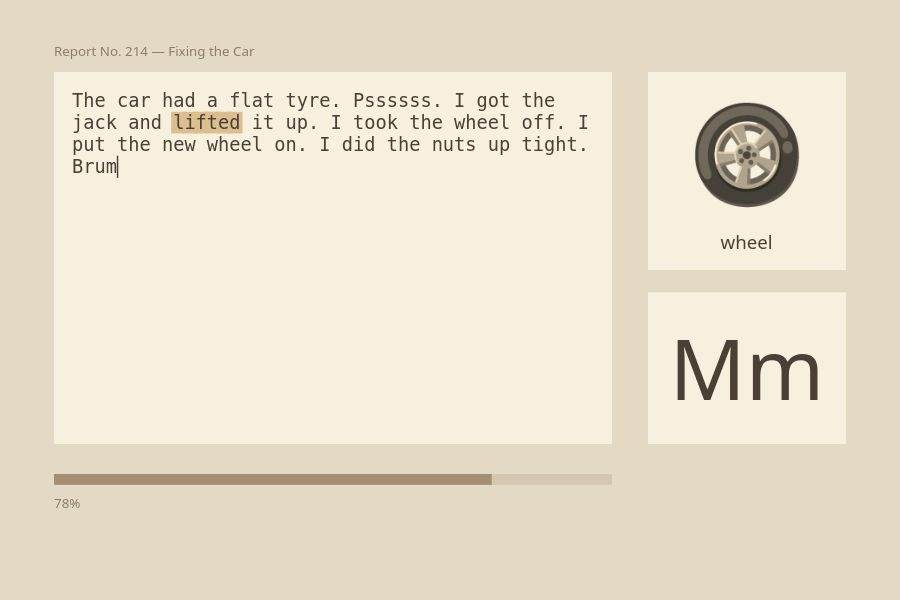

# Toddler Desk

A calm, deliberately boring full-screen "work" app for a toddler who wants to
type on the grown-ups' laptop. Every key press writes the next letter of a
short pretend report ("Fixing the Car", "Rock Pool Report", "Bin Lorry
Report"), a progress bar fills, and the report is "saved". Nothing flashes,
nothing rewards; the idea is that he feels he is doing work, not that the
screen is fun.



- **Writing:** any key or tap writes the next letter of the report.
- **Picture and letter:** a warm-greyscale picture of the word being written
  (word printed underneath) and the latest letter ("Mm"). Tap either to hear it.
- **Read aloud:** tap any word in the writing to hear the sentence from there,
  highlighted word by word. It never reads past what's on screen.
- **Kiosk lock:** while it runs, GNOME shortcuts, the Super key, hot corner,
  notifications, gestures and the power button are switched off, and put back
  on exit.
- **British English throughout:** lorries, zed, aitch, nought, "Report No. 12";
  British voice (Kokoro `bm_lewis`).
- **Gentle on the eyes:** warm off-white, low-blue colours.

Made for GNOME on Wayland (tested on Ubuntu with GNOME 50, a Dell XPS 13 with
touchscreen). Python 3 + GTK 4.

## Getting out

The app locks the desktop on purpose, so learn the exits before you try it:

- **Ctrl + Alt + Shift, then P and I** (together, or P then I). Either Alt works.
- **Ctrl + Alt + Shift + I** also quits, through a GNOME shortcut, even if the
  window has lost keyboard focus.
- **Tap Esc 8 times:** a line in the top-right corner asks for two random
  letters pressed together.
- **From another machine (SSH):** `toddler_desk.py --quit`.

If it ever dies without cleaning up (e.g. a power cut), run
`toddler_desk.py --restore` to put your GNOME settings back. The login item
below does this automatically.

## Setup

Needs Python 3 with PyGObject and GTK 4 (`python3-gi`, `gir1.2-gtk-4.0` on
Ubuntu) and PipeWire's `pw-play`.

```sh
git clone https://github.com/searbe/toddler-desk.git ~/toddler-desk
cd ~/toddler-desk
python3 setup_tts.py        # voice: uv, a venv, the Kokoro model (~350 MB download, ~700 MB on disk), all under tts/
python3 toddler_desk.py --test   # 900x600 window for 3 seconds, changes nothing
./run.sh                    # the real thing: full screen, locked
```

Without `setup_tts.py` the app still works, just silently.

Optional:

- **Launcher:** point a `.desktop` file or `~/.local/bin/toddler` at `run.sh`.
  It always restores GNOME settings when the app exits, even after a crash.
- **Restore at login:** copy `autostart/toddler-desk-restore.desktop` to
  `~/.config/autostart/`, editing the path inside if you didn't clone to
  `~/toddler-desk`.
- **Speech checks:** `python3 setup_tts.py --dev` adds Whisper for
  `./say --check`.

## How it works

- `toddler_desk.py` is the app. It locks and restores GNOME settings, draws
  the desk and handles the exits.
- `reports/*.md` holds one report per file: `# Title`, a blank line, then the
  story. Add your own; keep them short and boring.
- `icons.py` maps words to pictures. A word only gets a picture if the emoji
  really shows that thing as the reports use it.
- `voice.py` runs the live text-to-speech (Kokoro via kokoro-onnx) as a child
  process. Clips are cached on disk and made just ahead of the writing:
  - picture words one word ahead
  - sentences one sentence ahead, with a clip from every word position, so a
    tapped word plays instantly
- `say` lets you hear exactly what the app says: `./say banana`, `./say -l h`.

The app and the voice log to `~/.local/state/toddler-desk/toddler.log`.

`NOTES.md` has the background: what was tested and why things are the way
they are (Kokoro's quirks, GNOME gesture loopholes, speech checks with
Whisper). `CLAUDE.md` has the house rules for changes.

## Credits and licences

Toddler Desk's own code, reports and docs are MIT licensed (see `LICENSE`).

None of the following is included in this repository. `setup_tts.py`
downloads or installs them, or they come with your system. Each keeps its own
licence:

- **Kokoro-82M** text-to-speech model by hexgrad, Apache License 2.0
  (https://huggingface.co/hexgrad/Kokoro-82M). The ONNX export and voice file
  are downloaded from the kokoro-onnx releases. `setup_tts.py` makes a
  modified local copy of the model (`kokoro-v1.0-timed.onnx`) that also
  outputs each sound's duration; it is not distributed.
- **kokoro-onnx** by thewh1teagle, MIT License
  (https://github.com/thewh1teagle/kokoro-onnx).
- **eSpeak NG**, GNU GPL v3 or later (https://github.com/espeak-ng/espeak-ng),
  used to turn text into phonemes. It is installed into the voice's own
  virtual environment (via `espeakng-loader`) and runs in a separate process.
- **ONNX Runtime** by Microsoft, MIT License; **ONNX**, Apache License 2.0;
  **NumPy**, BSD licence; **soundfile**, BSD 3-Clause.
- **uv** by Astral, MIT or Apache 2.0, downloaded by `setup_tts.py`.
- **Noto Color Emoji** by Google, SIL Open Font License 1.1. The pictures are
  emoji drawn from your system's emoji font.
- **GTK 4 and PyGObject**, GNU LGPL, from your system.
- Optional, for speech checks only: **faster-whisper** by SYSTRAN (MIT) and
  OpenAI's **Whisper** models (MIT).
